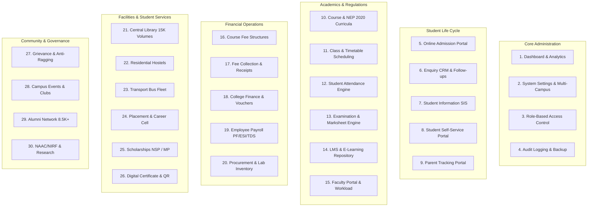
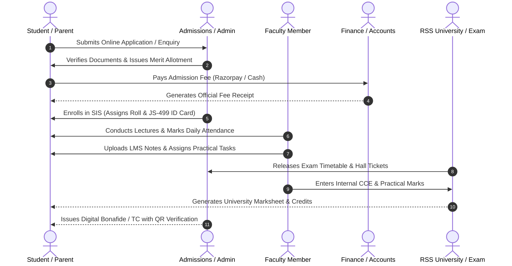

# D.P. Chaturvedi College (DPCC) ERP — System Architecture, RBAC & Complete User Guide

## Institutional Overview & Profile
* **Institution:** D.P. Chaturvedi College (DPCC), Seoni, Madhya Pradesh (Est. 2000)
* **Affiliation:** Raja Shankar Shah University, Chhindwara (formerly RDVV) &bull; Code: **JS-499**
* **Regulatory Compliance:** NAAC-Accredited & NCTE-Recognized (B.Ed. & D.El.Ed.) &bull; NEP 2020 Compliant
* **Helpline:** 07692-226635 &bull; **Email:** dpccollegeseoni@gmail.com &bull; **Web:** [www.dpccollege.com](https://www.dpccollege.com/)

---

## 1. Role-Based Access Control (RBAC) Matrix

The software strictly segments access across 6 distinct roles. The table below outlines **who gets how many features** and what permissions they possess:

| # | Role | Total Modules | Portal / View | Core Capabilities |
| :---: | :--- | :---: | :--- | :--- |
| **1** | **Super Administrator** *(Principal Dr. Amita Chaturvedi & Office)* | **30 / 30** (100% Full Access) | Executive Dashboard (`/dashboard`) | Full governance, master setups, student info system (SIS), employee HR & payroll, fee structures, university liaison, exam marks publishing, certificates, NAAC SSR metrics, and system backups. |
| **2** | **Faculty / Professor** *(HODs & Teaching Staff)* | **8 Modules** | Faculty Portal (`/portal/faculty`) | Class timetable schedules, daily attendance entry, CCE/internal exam grading, LMS notes/assignments/discussions, student leave reviews, library access, and personal leave applications. |
| **3** | **Student** *(Enrolled Scholars)* | **6 Modules** | Student Portal (`/portal/student`) | Live weekly timetable, subject attendance percentages, admit card download, official marksheet viewing, assignment uploads, fee dues & receipts, and digital ID card. |
| **4** | **Parent / Guardian** *(Parents & Sponsors)* | **4 Modules** | Parent Portal (`/portal/parent`) | Multi-child progress tracking, real-time subject attendance & shortage warnings (<75%), semester grade cards, and fee balance payment tracking. |
| **5** | **Accountant / Finance** *(Accounts Section)* | **5 Modules** | Finance Desk (`/fees`, `/finance`) | Course fee collection, payment receipts, general ledger & vouchers with GST/TDS, monthly salary payroll processing with PF/ESI, and procurement purchase orders. |
| **6** | **Librarian** *(Central Library)* | **3 Modules** | Library Desk (`/library`) | 15,000+ volume catalogue, barcoded accession registers, book issue/return/renewal, and automated overdue fine calculations. |

---

## 2. Complete 30-Module Feature Catalog

### Module Breakdown by Functional Pillar

#### Pillar I: Admissions & Student Information (SIS)
1. **Executive Dashboard & Analytics**: Real-time KPI cards for enrollment, faculty headcount, fee collection vs. expenses, library issues, and visual Chart.js graphs.
2. **Online Admission Management**: Public application interface (`/apply`), MP e-Pravesh verification, Aadhaar consent, cutoff merit list calculator, and instant application receipts.
3. **Enquiry & Admission CRM**: Lead capture for walk-ins, phone inquiries, counselor assignment, follow-up calendar, and WhatsApp/SMS broadcast triggers.
4. **Student Information System (SIS)**: 360-degree student profiles, academic history, categories (General/OBC/SC/ST/EWS), guardian details, document vault, and printable digital ID cards (`/students/{id}/id-card`).

#### Pillar II: Academics, NEP 2020 & Examinations
5. **Course & Curricula Management**: Supports DPCC's Science (B.Sc., M.Sc.), Commerce (B.Com., M.Com.), Arts (B.A., M.S.W.), and NCTE-recognized Teacher Education (B.Ed., D.El.Ed.) with credit systems.
6. **Class & Timetable Engine**: Class section allocations, classroom conflict checks, lab session scheduling, and teacher substitution planning.
7. **Attendance Management**: Daily lecture-wise and practical attendance marking, automated shortage calculations, and alerts for attendance below 75%.
8. **Examination & Grading Engine**: Internal CCE, Mid-term, and Raja Shankar Shah University End-term examinations; hall tickets/admit cards generation (`/exams/{exam}/admit-card/{student}`), marks entry, and marksheets (`/students/{id}/marksheet`).
9. **Learning Management System (LMS)**: Syllabus repositories, PDF study notes, assignment submissions with grading feedback, and subject-specific academic discussion boards.

#### Pillar III: Finance, HR & Payroll
10. **Fee Structures & Accounts**: Semester and annual fee templates, category-based fee concessions, installment tracking, and printed 80G-compliant fee receipts (`/fees/payments/{id}/receipt`).
11. **College Accounting & Ledger**: Chart of Accounts, General Ledger, cash/bank vouchers with GST and TDS compliance, and departmental operating budgets.
12. **Faculty & Staff HR**: Employee profiles, designations, educational credentials, teaching workloads, and leave approval workflows.
13. **Payroll Engine**: Automated monthly payroll computations including Basic, HRA, DA, TA, Provident Fund (PF), Professional Tax (PT), and TDS deductions with printable payslips (`/payroll/{id}/payslip`).
14. **Procurement & Inventory**: Purchase requisitions, purchase orders (PO), vendor management, lab apparatus, and departmental stock registers.

#### Pillar IV: Campus Facilities & Extracurriculars
15. **Central Library (15,000+ Volumes)**: Accession registry, barcode tracking, book issues, returns, renewals, and automated fine calculation for overdue items.
16. **Residential Hostels**: Room and bed allocations for Vivekananda Boys' Hostel and Sarojini Devi Girls' Hostel, mess fee billing, and student outing approvals.
17. **Transport Fleet Management**: Bus registry (MP-28 series), GPS tracking, and route allocation across Seoni, Lakhnadon, Chhapara, Barghat, Keolari, and Kurai tehsils.
18. **Placement & Career Cell**: Campus drives by corporate recruiters (IT, banking, agro-industry), eligibility screening, and offer letter tracking.
19. **Scholarships & Financial Aid**: MP Post-Matric SC/ST/OBC Scholarship and Dr. K.K. Chaturvedi Institutional Merit Awards tracking and disbursement status.
20. **Digital Certificates with QR Verification**: Issue Bonafide, Transfer (TC), Character, and Migration certificates featuring tamper-evident QR verification tokens (`/verify-certificate/{token}`).

#### Pillar V: Governance & Quality Assurance
21. **Grievance Redressal**: Confidential submission and resolution portal for academic grievances, harassment complaints, and anti-ragging compliance.
22. **Campus Events & Seminars**: Event planning, auditorium reservations, annual fest planning, and sports meet budgeting.
23. **Alumni Association Network**: Alumni database spanning 8,500+ graduates since 2000, mentorship programs, and donation records.
24. **Accreditation (NAAC & NCTE)**: NAAC Criteria 1–7 evidence archives, AISHE Data upload registers (Code: JS-499), and NCTE Teacher Education compliance files.
25. **Research & Innovation**: Faculty research papers, patents, and state-funded research projects.
26. **Multi-Campus & Institution Settings**: Institutional name, grading scales (10-point UGC scale), payment gateways, and system backup utilities.

---

## 3. How Everything Works: End-to-End Operational Lifecycle

### Key Workflows Explained

1. **Student Enrollment & Onboarding**:
   - The prospective student registers via the public admission page (`/apply`).
   - The administration team evaluates qualifying percentages (10th/12th/UG), checks category criteria (MP Domicile, SC/ST/OBC), and updates status to `Verified`.
   - Upon initial fee deposit, the student is converted into an active SIS record with a college enrollment number (e.g., `DPCC26BSC01`).

2. **Daily Academic Routine**:
   - Every morning, faculty members open the **Faculty Portal** on tablet or desktop.
   - The faculty selects their assigned course and section (e.g., B.Sc. PCM 3rd Sem) and marks students as `Present`, `Absent`, or `Late`.
   - If a student's cumulative attendance drops below 75%, an automated warning is posted to the student and parent portals.

3. **Continuous Evaluation & Examinations**:
   - Faculty create CCE internal assessments and upload marks directly into the **Examinations** module.
   - Admit cards are batch-generated with assigned seating and room numbers.
   - Following end-semester evaluations, marksheets are compiled using the UGC 10-point grading scale (O, A+, A, B+, B, C, F).

4. **Fee Reconciliation**:
   - The accountant logs into the **Fees Desk** (`/fees`), locates the student via roll number or name, and records payments.
   - The system automatically balances the payment against Tuition, Examination, Library, and Lab components and prints a stamped receipt.

---

## 4. End-User Guides by Role

### 4.1 Guide for Super Administrator (Principal & Office)
* **Login**: Navigate to `/login` and select **Principal / Admin** (`admin@dpccollege.com` / `password`).
* **Managing Students**: Go to **Admissions & SIS > Student Info (SIS)** to add students, upload KYC documents, or print student ID cards.
* **Creating Academic Structure**: Access **Academics & Exams > Courses & NEP 2020** to define departments (Science, Commerce, Arts, Education) and create syllabus credit requirements.
* **HR & Payroll**: Go to **Finance, HR & Assets > Faculty & Staff HR** to manage employee records, and run monthly salary batches via **Payroll**.
* **Accreditation**: Visit **NAAC/NIRF & Research** to catalog metric documentation for NAAC SSR submission.

### 4.2 Guide for Faculty Members
* **Login**: Navigate to `/login` and select **Faculty** (`faculty@dpccollege.com` / `password`).
* **Marking Attendance**: Click **Academics & Exams > Attendance**, select your section from the dropdown, check the absent students, and submit.
* **Managing Course Materials**: Open **LMS & E-Learning**, click **Add Material**, provide the lecture title and attach the PDF syllabus notes.
* **Grading Submissions**: In the LMS tab, review assignments submitted by students, assign scores (e.g., out of 20), and leave constructive remarks.
* **Applying for Leave**: Open **Campus & Portals > Faculty Portal**, fill in your leave dates (Casual/Medical) and reason, and monitor approval status.

### 4.3 Guide for Students
* **Login**: Navigate to `/login` and select **Student** (`student@dpccollege.com` / `password`).
* **Viewing Schedule**: The **Student Portal** displays your current weekly timetable, classroom numbers, and faculty names.
* **Attendance Check**: View real-time subject-wise percentage bars to verify you remain safely above the mandatory 75% threshold.
* **Downloading Admit Cards & Marksheets**: Click on **My Examinations** to download your hall ticket prior to exams, and view your verified SGPA/CGPA marksheet upon publication.
* **LMS Submissions**: Access **Learning Materials** to review professor notes and upload completed assignments before the due date.

### 4.4 Guide for Parents & Guardians
* **Login**: Navigate to `/login` and select **Parent** (`parent@dpccollege.com` / `password`).
* **Multi-Child Dashboard**: The parent portal displays linked children with real-time academic standing.
* **Monitoring Attendance**: Review overall attendance metrics; an orange or red banner highlights any subject where attendance is below 75%.
* **Fee Status**: Check pending fee balances, breakdown of tuition vs. bus/hostel fees, and review past transaction receipts.

### 4.5 Guide for Accountants & Librarians
* **Accountant**:
  - Open `/fees` to process student payments, apply scholarship credits, and issue receipts.
  - Access `/finance` to create journal vouchers for college expenditures with appropriate GST/TDS entries.
* **Librarian**:
  - Open `/library` to look up any of the 15,000+ volumes by accession barcode or title.
  - Enter the student's enrollment number to issue books or process returns with automated overdue fine calculation.
